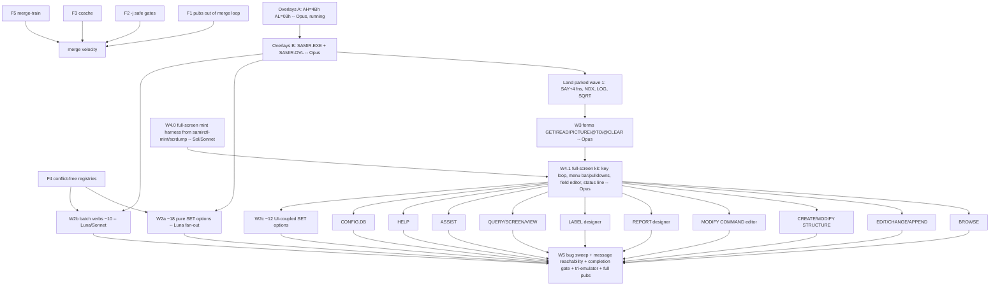

# InitechBase ship plan -- work DAG, model routing, build economics

Status: DRAFT for operator approval (2026-10-25). Beads epic: initech-6l91v (wave 1),
initech-5etom (overlays). Ship gate = the operator's 2026-10-24 definition: every
III+ 1.1 verb/function/SET option shipped-with-real-golden or a documented
omission in samir.allow; catalogue-message reachability and the SAMIR bug list
driven to zero; manuals in lockstep.

## 0. Where we are (measured, 2026-10-25)

| Surface | Shipped on main | Remaining |
|---|---|---|
| Functions | 12/18 wave-1 + all prior | 6 done-but-parked (ROW COL PROW PCOL on lane/wave1-say; NDX LOG SQRT in lanes) -- blocked on overlays |
| SET options | 17 (+DEVICE parked) of ~47 | ~30 (about a third only mean something once full-screen exists) |
| Commands | 64 (+@ parked) | batch verbs (~10) + forms (wave 3) + full-screen apps (wave 4) |
| Bugs | -- | 18 open SAMIR/InitechBase (3 P1) |
| Messages | 146 catalogued | 94 still DRAFT/unreachable |
| Size | SAMIR.COM 100,777 B on main | the 4 KiB headroom floor is reached; overlays (initech-5etom) gate everything else |

## 1. Build/test economics (the merge-velocity problem)

Measured on this box (64 cores, 62 GB, no ccache, no default -j):

| Step | Today | Why |
|---|---|---|
| test-samir-fns host suite (24 cases, after a rebuild) | 2.7 s | fine |
| one -emu leg | ~3 s; 4 legs serial 12.2 s, -j4 4.5 s | fns emu legs are -j safe |
| one -mutant build+run | ~2 s; -j16 gave no gain | mutants chained serially in the Makefile |
| test-pubs-tps (InitechBase lockstep) | **302 s even with nothing changed** | depends on test-pubs-build: rm -rf gate dir + 41 LuaLaTeX docs, serial |
| test-pubs-examples | another ~300 s | same dependency, typesets again |
| test-pubs-screens | ~700 s | 82 QEMU screens, serial |
| one book (initechbase-volume-one) warm | 42 s | the book target re-runs latexmk regardless |
| PM merge run (gates for 1-6 functions) | ~6 min, of which >5 min typesetting | |

Operator ruling (2026-10-25): typesetting runs once per session or less, never per merge.

Factory track F (do first; it multiplies everything after it):

- **F1 Per-merge pubs out (small, Sonnet).** A source-level lockstep check
  `test-pubs-lockstep-src`: every shipped name (pubs_samir_inventory, already
  fast) has an `\begin{XbaseEntry}{NAME}` / SET / command entry in the .tex
  sources, plus every new `examples/*.dot` has its `.txt`. Milliseconds.
  Mutant: delete one entry -> RED. The LaTeX-derived checks
  (tps/commands/examples/screens) move to `make test-pubs` per session.
- **F2 Parallel-safe gates (small, Sonnet).** Fix initech-b9oa (shared
  tracer_secondary.img under -j: key per case or order-only chain), un-chain
  the mutant builds, then make the merge gate set run under `make -j32`.
  Target: merge gate set for a 6-lane batch < 60 s.
- **F3 ccache shared across lane clones (trivial, Haiku/Luna).** `CC="ccache cc"`
  host side, shared `CCACHE_DIR`; lane clones start warm. Reproducibility
  gates unaffected (ccache is output-identical; prove with test-*-repro).
- **F4 Conflict-free registration (medium, Sonnet).** Everything every lane
  touches becomes append-by-file, not edit-a-shared-line:
  SAMIR_FNS_CASES/PENDING derived from per-case marker files
  (fns-mint/<case>/ACCEPTED), one .tex file per Reference entry included via a
  generated sorted index (kills the u6-entries/qr-functions conflicts), SET
  keyword table and command verb table generated from per-item rows (kills the
  `case 16` collision class). pal_null is already designated (b453e554).
- **F5 Merge train script (small, Sonnet; Sol review).** `tools/merge-train.sh
  <lane>...`: apply each lane 3-way onto main, auto-resolve union-only
  conflicts in the known registries, run the merge gate set once with -j,
  commit per lane, push. PM stays the gatekeeper (Rule 4: re-runs, reads
  diffs); the script removes the clerical minutes.
- **F6 Per-session pubs, parallel and scoped (small, Sonnet).** build.sh pass 1
  over documents with `xargs -P` (pass 2 master index after), and keep the
  clean-build route for `test-pubs-repro`. Expected per-session test-pubs from
  ~20 min to ~3-4 min (bounded by volume-one ~45 s x 2 passes + screens -j).
- **F7 Measure the full vector under -j (Sonnet, after F2).** `make -j32 test`
  wall time recorded in the worklog; fix whatever is not parallel-safe; full
  vector + Bochs legs once per session (end) instead of ad hoc.

F1+F3 can land today; F2/F4/F5 within one session; all are independent of the
product track except F4, which must land before wave 2 fan-out.

## 2. Model routing

| Role | Normal | Codex glut | Claude tight | Codex tight |
|---|---|---|---|---|
| Hard/core coding (overlays, forms, full-screen kit, BROWSE, editor, designers, ASSIST) | **Opus** | **Sol** (high) | Sol | Opus |
| Standard coding (one function, one SET option, one batch verb, bug with a clear golden) | **Luna / Haiku** | Luna | Luna | Haiku |
| Mid work (factory tasks F*, manual entries, mint scripts, CONFIG.DB/HELP wiring, bug triage) | **Sonnet** | Luna (high) | Luna | Sonnet |
| Targeted review (blocks of 3-6 small lanes) | **Sonnet** | Sol | Sol | Sonnet |
| Rottweiler review (every Opus/Sol core lane; anything touching flow.c/eval.c/pal.h/screen.c/overlay manager) | **Sol** | Sol | Sol | Opus (fresh context) |
| PM (merge train, rulings, beads, Rule-4 re-runs) | Opus (this seat) | same | same | same |

Rules of thumb: a reviewer never shares a family with the coder on core work
(Opus code -> Sol review; Sol code -> Opus or Sonnet review). Glut mode widens
fan-out (more concurrent lanes), not depth; the bound is merge velocity, so in
glut mode also spend Codex on review depth (second Sol pass on core lanes) and
on mint work (goldens are the long pole for waves 3-4).

## 3. The DAG

Parallel from today, off the critical path: F1-F7; W4.0 mint harness;
the 18-bug sweep for bugs not in code the overlays move; W2a/W2b goldens
minting (mint-first, Lane-0 shape) even before overlays land; omission rulings
(CALL/LOAD binary modules, IMPORT/EXPORT PFS, SET DEBUG/ECHO/STEP?) as an
operator decision list.

Critical path: A -> B -> W3 -> W4.1 kit -> (widest W4 app, likely ASSIST or the
REPORT designer) -> W5 gate.

## 4. Work items, sizing and times

Times are wall-clock estimates from this session's observations: a Sol/Luna
one-function lane took 10-40 min; Sonnet block review of 3-5 lanes 1.5-2 min
(60-100 k tokens); a Sol deep review ~15-30 min; PM merge today ~6 min, target
<2 min after F1/F2/F5. Opus core lanes are the unknown; estimates below are
honest ranges, to be replaced by measured values in the worklog.

| Item | Lanes | Coder | Reviewer | Lane wall | Review | Merge gates (post-F) |
|---|---|---|---|---|---|---|
| F1-F7 factory | 6 | Sonnet/Haiku | Sonnet, Sol for F5 | 0.5-2 h each, parallel | 5 min | 1 min |
| A overlays AL=03h | 1 | Opus | Sol | 2-4 h (running) | 30 min | kernel + EXEC emu/Bochs ~5 min |
| B SAMIR.EXE + SAMIR.OVL | 1 (maybe 2: manager / build split) | Opus | Sol x2 | 1-2 sessions | 1 h | every SAMIR gate + Bochs ~10 min |
| Land parked wave 1 | train | PM | -- | -- | done | 2 min |
| W2a pure SET options (~18) | 18 + Lane 0 mint | Luna | Sonnet blocks of 6 | 15-40 min | 3 x 2 min | 3 trains |
| W2b batch verbs (~10) | 10 + mint | Luna; Sonnet for JOIN/UPDATE | Sonnet | 30-90 min | 2 x 2 min | 2 trains |
| W3 forms | 1-2 | Opus | Sol | 1 session | 1 h | 5 min |
| W4.0 full-screen mint | 1 | Sol (or Sonnet) | Sonnet | 2-4 h | 15 min | -- |
| W4.1 full-screen kit | 1 | Opus | Sol | 1 session | 1 h | 5 min |
| W4 apps (10) | 10, max ~4-5 concurrent Opus | Opus (glut: Sol) | Sol each | 0.5-2 sessions each | 30-60 min | 5 min each |
| W2c UI-coupled SET (~12) | 12 | Luna/Sonnet | Sonnet | 30-60 min | blocks | 2 trains |
| W5 sweep (18 bugs, 94 messages) | ~15 | Luna/Sonnet; Opus for flow/eval bugs | Sonnet; Sol for core | 30-90 min | blocks | trains |
| W5 completion gate + ship | 1 | Sonnet | Sol | 2 h | 30 min | full vector -j + Bochs + 86Box + pubs |

Concurrency envelope: ~20 lanes at once is fine for the machine (64 cores;
each lane's builds are seconds once ccache is warm); the real cap is review +
merge throughput: with F1-F5, one PM can absorb a merge train of up to ~6 small
lanes every ~10 minutes, or one core lane per ~30 minutes (dominated by reading
the diff, not gates).

## 5. Cadence

- Per lane: RED first, GREEN, mutant, emu leg; lane runs the merge gate set on
  main+lane before reporting (lane-owned integration), never typesetting.
- Per merge train (every 30-60 min while lanes are flowing): PM reads diffs /
  review verdicts, runs merge-train.sh (gates -j, <2 min), pushes.
- Per session end: `make -j32 test` (measured in F7), Bochs legs, full
  `make test-pubs` (parallel, per F6), gs-dir style screen re-captures once,
  worklog shard, beads updated, push.
- Per wave end: 86Box authenticity pass for anything user-visible (Law 4 clip
  for window/screen features per Rule 14 where it applies).

## 6. Open operator decisions

1. Omissions: CALL/LOAD (binary .BIN modules), IMPORT/EXPORT (PFS:File), SET
   DEBUG/ECHO/STEP (debugger) -- implement or document as omissions?
2. Overlay granularity in Phase B: one overlay slot (authentic, simplest) vs a
   few slots (fewer swaps for ASSIST/BROWSE).
3. Whether the lane-owned integration run (section 5) is trusted for small
   lanes with the PM re-running only the train (Rule 4 still applies to the
   train result).
